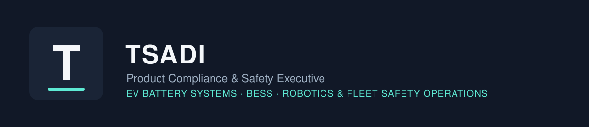
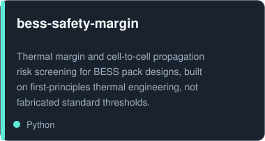
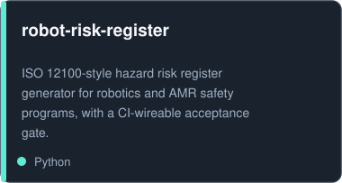
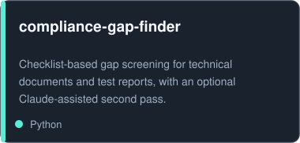
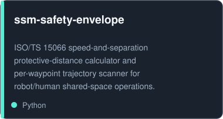
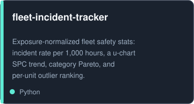
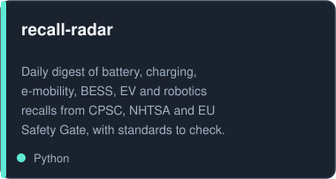
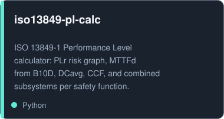
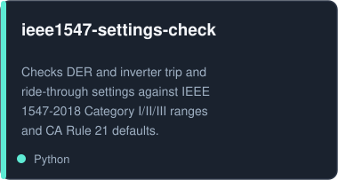
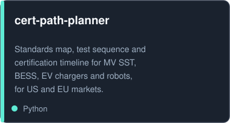

       

Product Compliance & Safety Executive with about two decades of certification, safety engineering, and safety-operations experience across EV battery systems, BESS, and robotics/robot-fleet hardware. Now building the tooling that turns that experience into live operational safety practice: fleet risk monitoring, incident tracking, and deployment-readiness checks, not just paper certification.

## Background

Certification and safety work across FCC, UL, IEC, and CE/RED schemes. Hands-on experience at Ample, Pax Labs, Safety Engineering Laboratory, Silicon Valley Compliance, and Kodak/Creo. I run "Product Safety and Compliance," a 6,000+ member LinkedIn community for people doing this work.

## Projects

Every project above ships with tests, a documented methodology, and an explicit "what this is not" section. No fabricated numbers, no hardcoded pass/fail thresholds pretending to be standards text.

## Contact

[Product Safety and Compliance on LinkedIn](https://linkedin.com/groups/2278131)
